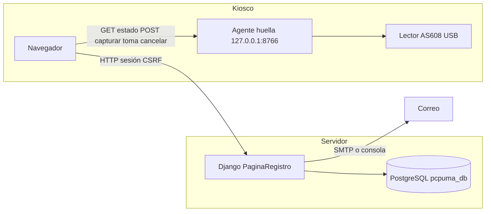

# Préstamo de equipos (pcPuma)

Sistema web para el préstamo de equipo en ventanilla. El personal (`is_staff`) registra usuarios, inventario, préstamos y sanciones. La persona que recibe o devuelve el equipo se autentica con contraseña o con huella. El lector USB no lo abre Django: lo abre un agente local en cada kiosco.

El nombre interno de la base y de los contenedores es `pcpuma`. La interfaz muestra «Préstamo de equipos» y el pie «Universidad Nacional Autónoma de México».

## Stack

| Capa | Qué hay en el repositorio |
|------|---------------------------|
| Aplicación | Django. `settings.py` indica que el proyecto se generó con Django 6.1.1. Las migraciones iniciales dicen Django 6.1.2. `requirements.txt` declara `Django` sin versión fija. |
| Base de datos | PostgreSQL 15 (`postgres:15-alpine`) vía `psycopg2-binary`. El bloque SQLite de `settings.py` está comentado. |
| Interfaz | Plantillas Django. Tailwind se carga desde `https://cdn.tailwindcss.com` y la fuente DM Sans desde Google Fonts (`Usuarios/_assets.html`). |
| Correo | `django.core.mail.send_mail`. Sin `EMAIL_HOST`, el backend es la consola. |
| Huella | Sensor AS608 por USB. El agente usa `pyserial` y el protocolo propio de `Usuarios/hardware/verificar_as608.py`. Las minucias salen de `fingerprint-enhancer`, `fingerprint-feature-extractor`, OpenCV, NumPy y Pillow. |
| Contenedores | Solo PostgreSQL y pgAdmin. La aplicación Django no tiene Dockerfile. |

## Arquitectura de alto nivel

Hay dos procesos. El servidor corre Django y PostgreSQL. Cada kiosco corre el navegador y el agente de huella en `127.0.0.1:8766`. El navegador manda las minucias a Django; Django compara o guarda. Django no abre el puerto serie.



El detalle de flujos, seguridad y hardware está en [docs/ARQUITECTURA.md](docs/ARQUITECTURA.md).

## Estructura

```
prestamoequiposweb/
├── requirements.txt          # Django y librerías del servidor y del lector
├── prueba_as608.py           # Script suelto con Adafruit y puerto COM4 fijo
├── to_do.txt
├── agente-kiosco/            # Empaquetado del agente, sin Django ni Postgres
└── PaginaRegistro/
    ├── manage.py
    ├── docker-compose.yml    # Postgres y pgAdmin
    ├── PaginaRegistro/       # settings, urls, wsgi, asgi
    ├── Usuarios/
    ├── Inventario/
    └── Prestamos/
```

Las plantillas versionadas están en directorios `Templates/` (T mayúscula). Django busca `templates`. En un sistema de archivos que no distingue mayúsculas los dos nombres son el mismo directorio. En un Linux que sí las distingue, el cargador de aplicaciones no encuentra esas plantillas. `TEMPLATES['DIRS']` vale `['']` y no corrige esa ruta.

## Requisitos previos

- Python 3.10 o superior. Lo pide `agente-kiosco/instalar.bat` y el README del agente. El repositorio no fija la versión en un archivo `runtime.txt` ni en `pyproject.toml`.
- Docker y Docker Compose, para PostgreSQL y pgAdmin.
- Para usar el lector en la misma máquina: adaptador USB serie (el código prefiere Silicon Labs CP210x) y el sensor AS608.

El registro y el préstamo pueden probarse con contraseña sin lector. La huella necesita el agente en marcha.

## Instalación y ejecución local

Los comandos de Django se ejecutan dentro de `PaginaRegistro/`, porque ahí están `manage.py` y `docker-compose.yml`. Las dependencias están en la raíz del repositorio.

1. Crear el entorno e instalar dependencias, desde la raíz del clon:

   ```bash
   python3 -m venv venv
   source venv/bin/activate
   pip install -r requirements.txt
   ```

   En Windows el activador del venv es `venv\Scripts\activate`. El agente de kiosco usa sus propios scripts `.bat`.

2. Levantar PostgreSQL y pgAdmin:

   ```bash
   cd PaginaRegistro
   docker compose up -d
   ```

   El archivo también declara `version: '3.8'`, así que `docker-compose up -d` sigue siendo válido en Compose V1. Postgres publica el puerto **5433** del host hacia el 5432 del contenedor. pgAdmin publica el **5050**.

3. Aplicar migraciones y crear un superusuario. `USERNAME_FIELD` es el correo. `REQUIRED_FIELDS` son `nombre` y `apellidos`.

   ```bash
   python manage.py migrate
   python manage.py createsuperuser
   ```

   `createsuperuser` usa `CustomUserManager.create_superuser`, que marca `is_staff` e `is_superuser`.

4. Arrancar Django:

   ```bash
   python manage.py runserver
   ```

   Con `DEBUG = True` y `ALLOWED_HOSTS = []`, el servidor de desarrollo acepta localhost. La raíz `/` es el login.

5. Si se va a leer la huella en esta misma computadora, en otra terminal y desde la raíz del repositorio:

   ```bash
   python agente-kiosco/arrancar.py
   ```

   El agente escucha en `http://127.0.0.1:8766`. Hay que dejarlo encendido mientras el navegador captura.

pgAdmin: `http://localhost:5050`. El correo y la contraseña de entrada están en `PaginaRegistro/docker-compose.yml` (`PGADMIN_DEFAULT_EMAIL`, `PGADMIN_DEFAULT_PASSWORD`). Dentro de pgAdmin, el host de la base es `db_pcpuma` y el puerto `5432` (red interna de Compose). Desde el host, Django usa `localhost` y el puerto `5433`.

## Variables de entorno

Ningún módulo carga un archivo `.env`. `.gitignore` ignora `.env`, pero hay que exportar las variables en el entorno del proceso. Si no se exportan, aplican los valores de la tabla.

La base de datos **no** sale de variables de entorno. `PaginaRegistro/settings.py` y `docker-compose.yml` repiten los mismos literales.

| Variable | Quién la lee | Valor si no está definida | Para qué sirve |
|----------|--------------|---------------------------|----------------|
| `EMAIL_HOST` | `settings.py` | vacío | Si tiene valor, el backend pasa a SMTP. Si está vacío, los correos se imprimen en la consola del servidor. |
| `EMAIL_BACKEND` | `settings.py` | `console.EmailBackend`, o `smtp.EmailBackend` cuando hay `EMAIL_HOST` | Fuerza el backend de correo. |
| `EMAIL_PORT` | `settings.py` | `587` | Puerto SMTP. |
| `EMAIL_HOST_USER` | `settings.py` | vacío | Usuario SMTP. |
| `EMAIL_HOST_PASSWORD` | `settings.py` | vacío | Contraseña SMTP. |
| `EMAIL_USE_TLS` | `settings.py` | `true` | TLS activo con `1`, `true` o `yes`. Cualquier otro texto lo apaga. |
| `DEFAULT_FROM_EMAIL` | `settings.py` | `prestamos@localhost` | Remitente de `send_mail`. |
| `HUELLA_AGENTE_URL` | `settings.py`, context processor `huella_agente` | `http://127.0.0.1:8766` | URL que el navegador usa para hablar con el agente. |
| `HUELLA_AGENTE_PUERTO` | `Usuarios/hardware/agente.py` | `8766` | Puerto en el que escucha el agente. Tiene que coincidir con `HUELLA_AGENTE_URL`. |
| `HUELLA_PUERTO` | `hardware.encontrar_puerto_arduino` | detección automática | Fuerza el COM o TTY del adaptador. |
| `HUELLA_BAUD` | `hardware._baud_pedido` | última velocidad que contestó, o `67200` | Fuerza la velocidad serie. Si el texto no es un entero, se ignora. |
| `DJANGO_SETTINGS_MODULE` | `manage.py`, `wsgi.py`, `asgi.py` | `PaginaRegistro.settings` | Lo fija el propio arranque. No hace falta exportarlo para `runserver`. |

Valores con los que el código de desarrollo ya conecta a Postgres (están escritos en `settings.py` y en `docker-compose.yml`, no en el entorno):

| Dato | Valor en el código |
|------|--------------------|
| Base | `pcpuma_db` |
| Usuario | `admin_pcpuma` |
| Contraseña | `password_seguro_123` |
| Host Django | `localhost` |
| Puerto Django | `5433` |

`SECRET_KEY` y `DEBUG = True` también están fijos en `settings.py`. No se leen del entorno.

Ejemplo de SMTP real, exportado antes de `runserver`:

```bash
export EMAIL_HOST=smtp.ejemplo.unam.mx
export EMAIL_PORT=587
export EMAIL_HOST_USER=prestamos@ejemplo.unam.mx
export EMAIL_HOST_PASSWORD=secreto
export EMAIL_USE_TLS=true
export DEFAULT_FROM_EMAIL=prestamos@ejemplo.unam.mx
```

## Comandos principales

Desde `PaginaRegistro/`, con el entorno virtual activo:

```bash
python manage.py migrate
python manage.py runserver
python manage.py createsuperuser
python manage.py test
```

Desde la raíz del repositorio:

```bash
python agente-kiosco/arrancar.py
python agente-kiosco/empaquetar.py
python agente-kiosco/test_empaquetar.py
python prueba_as608.py
```

`empaquetar.py` escribe `agente-kiosco/dist/agente-huella-kiosco-<version>.zip`. La versión sale de `VERSION_AGENTE` en `Usuarios/hardware/contrato.py` (hoy `1.3.0`). `prueba_as608.py` abre el puerto fijo `COM4` a 67200 baudios con la librería Adafruit. El camino que usa la web es el de `verificar_as608.py`, no ese script.

Pruebas, contenedores y el hueco de producción: [docs/DESPLIEGUE_Y_PRUEBAS.md](docs/DESPLIEGUE_Y_PRUEBAS.md).

## Documentación

| Documento | Contenido |
|-----------|-----------|
| [docs/ARQUITECTURA.md](docs/ARQUITECTURA.md) | Directorios, flujos, patrones, autenticación, hardware y correo |
| [docs/BASE_DE_DATOS.md](docs/BASE_DE_DATOS.md) | Modelos, relaciones, índices y migraciones |
| [docs/API_Y_RUTAS.md](docs/API_Y_RUTAS.md) | Vistas Django y HTTP del agente |
| [docs/DESPLIEGUE_Y_PRUEBAS.md](docs/DESPLIEGUE_Y_PRUEBAS.md) | Tests, Docker, kiosco y producción |
| [agente-kiosco/README.md](agente-kiosco/README.md) | Instalación del agente en el kiosco |
| [agente-kiosco/CONTRATO.md](agente-kiosco/CONTRATO.md) | Contrato HTTP del agente. La fuente de los números es `contrato.py` |

## Incompleto o desalineado con el código

- `to_do.txt` pide una app de sanciones y un botón de comentarios. El código ya tiene el modelo `Sancion` y la vista `AgregarComentarioView` dentro de `Prestamos`. No existe una app Django llamada Sanciones. El archivo no está marcado como resuelto.
- `StaffAuthenticationForm` está definido en `Usuarios/forms.py` y ninguna vista lo usa. El login usa `EmailLoginForm`.
- `Prestamos/identificar_usuario.html` está en las plantillas y ninguna vista lo nombra en `template_name`.
- `DispositivoCreateView` ejecuta `model.estado = "Disponible"` en el cuerpo de la clase. Eso sustituye el campo `Dispositivo.estado` por una cadena al importar la vista. El alta no muestra el campo `estado`; el default del modelo es `disponible`.
- No hay linter, CI, `STATIC_ROOT`, ni manifiesto de producción. `DEBUG` permanece en `True`.
