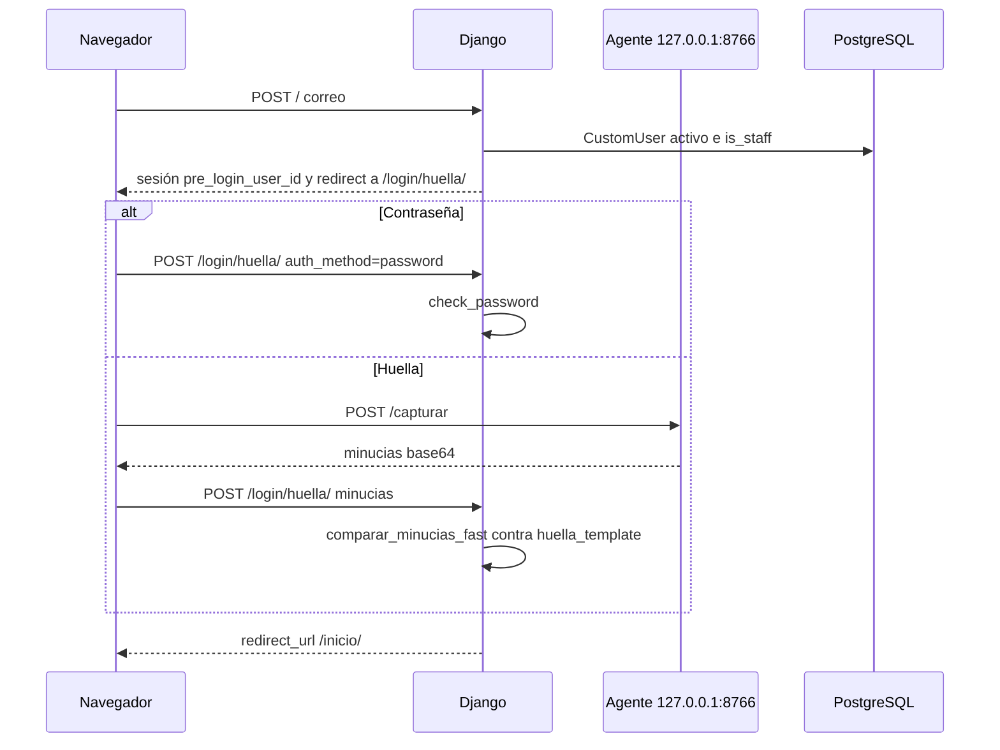

# Arquitectura

Aplicación Django de tres apps (`Usuarios`, `Inventario`, `Prestamos`) más un proceso local que lee el sensor de huella. La configuración vive en `PaginaRegistro/PaginaRegistro/settings.py`. El enrutado raíz está en `PaginaRegistro/PaginaRegistro/urls.py`.

## Estructura de directorios

```
PaginaRegistro/
├── manage.py
├── docker-compose.yml
├── PaginaRegistro/
│   ├── settings.py
│   ├── urls.py
│   ├── wsgi.py          # PaginaRegistro.wsgi:application
│   └── asgi.py          # PaginaRegistro.asgi:application
├── Usuarios/
│   ├── models.py        # CustomUser, Programa, EntidadAcademica
│   ├── views.py         # login, registro, perfil, APIs de huella
│   ├── forms.py
│   ├── admin.py
│   ├── correos.py       # correo libre desde el perfil
│   ├── context_processors.py
│   ├── urls.py
│   ├── hardware/        # lector, comparación y agente HTTP
│   ├── static/Usuarios/ # JS de entidades y fotos de la interfaz
│   └── Templates/Usuarios/
├── Inventario/
│   ├── models.py        # Categoria, Dispositivo
│   ├── views.py
│   └── Templates/Inventario/
├── Prestamos/
│   ├── models.py        # Prestamo, DetallePrestamo, Sancion
│   ├── views.py         # listados, devolución simple, sanciones
│   ├── registro_views.py
│   ├── devolucion_views.py
│   ├── correos.py       # confirmaciones de préstamo, sanción y devolución
│   └── Templates/Prestamos/
├── media/               # MEDIA_ROOT; fotos de dispositivos
└── huellas-gabor/       # PNG que el lector escribe si corre en este proceso
```

`agente-kiosco/` no es una app Django. `empaquetar.py` copia desde `Usuarios/hardware/` los módulos del lector y omite `biometria_cache.py`. El `__init__.py` del zip es más corto que el del servidor: solo reexporta `VERSION_AGENTE` y `VERSION_CONTRATO`.

`INSTALLED_APPS` añade `Usuarios`, `Inventario` y `Prestamos` a las apps `django.contrib` de admin, auth, contenttypes, sessions, messages y staticfiles. No hay `rest_framework`, canales ni tareas en segundo plano.

`AUTH_USER_MODEL` es `Usuarios.CustomUser`.

### Plantillas y estáticos

`TEMPLATES['APP_DIRS']` es `True`. El cargador de Django busca una carpeta llamada `templates` dentro de cada app. El repositorio versiona esas carpetas como `Templates/`. `TEMPLATES['DIRS']` es `['']`: una ruta vacía, el directorio de trabajo, no un directorio de diseño.

Los estáticos de interfaz están en `Usuarios/static/Usuarios/` (`profile.jpg`, `usuarios.jpg`, `dispositivos.png`, `prestamos.jpg`, `sansiones.jpg`, `admin_usuarios.jpg`, `js/entidades_por_programa.js`). `STATIC_URL` es `static/`. No hay `STATIC_ROOT` ni `collectstatic` en ningún script.

`MEDIA_URL` es `/media/` y `MEDIA_ROOT` es `PaginaRegistro/media`. `urls.py` sirve esos archivos solo cuando `DEBUG` es verdadero.

La hoja visual no está compilada en el repo. `_assets.html` inyecta Tailwind por CDN, define la paleta `unam` (`#002B5C`) y `gold` (`#D59F0F`), y el modo oscuro con la clase `dark` guardada en `localStorage` bajo la clave `theme`.

## Patrones

El proyecto sigue el MTV de Django.

- Vistas basadas en clases para pantallas y flujos. `StaffRequiredMixin` (hay una copia en `Inventario/views.py` y otra en `Prestamos/views.py`) exige `is_authenticated` e `is_staff`. `UserPassesTestMixin` manda al anónimo a `LOGIN_URL` (`login`) y responde 403 si la sesión existe y no es staff.
- Formularios de `ModelForm` vía `UserCreationForm` para el alta. El inventario usa los `fields` declarados en la vista, sin un `forms.py` propio.
- El alta de usuario no guarda la fila al enviar el formulario. `form_valid` deja los datos en la sesión (`temp_user_data`) y el usuario se crea cuando la cuarta toma de huella fusiona bien.
- El préstamo es un asistente de tres pasos. El estado va en `request.session['registro_prestamo']` (`usuario_id`, `dispositivo_ids`). La devolución con identificación guarda `devolucion_usuario_id`.
- `StaffUser` y `NormalUser` son modelos proxy de `CustomUser` para partir el admin. No tienen tabla propia.
- `IndiceBiometricoRAM` es un padrón en memoria del proceso Django: diccionario `usuario_id -> ndarray`, protegido por un `threading.Lock`. La primera identificación 1:N lo llena desde PostgreSQL. `actualizar_usuario` lo refresca al enrolar, sin reiniciar el worker. Un template que no descomprime se omite (el comentario del código menciona restos de 512 bytes del AS608).
- Los correos son funciones que arman texto plano y llaman a `send_mail`. Si el envío lanza, la función registra el error y devuelve `False`. El préstamo, la sanción y la devolución ya quedaron guardados.
- El agente es un `ThreadingHTTPServer` de la biblioteca estándar. Un candado impide dos lecturas a la vez. Una captura nueva, o `POST /cancelar`, marca un `threading.Event` para soltar la lectura en curso.

No hay capa de repositorio ni servicios inyectados. La lógica de negocio está en los modelos (`estado_ticket`, `agregar_comentario`, `tiene_sancion_activa`) y en las vistas.

## Flujo de datos

### Login de staff



`CustomLoginView` no llama a `login()`. Solo comprueba que exista un `CustomUser` activo con ese correo y `is_staff=True`, guarda `pre_login_user_id` y redirige a la segunda pantalla. `LOGIN_REDIRECT_URL = 'inicio'` no participa en ese `form_valid`. El `login()` de Django ocurre en `api_login_huella`, por contraseña o por huella con puntaje `>= 0.30`. La comparación de login es 1:1 contra la plantilla de esa cuenta, no una búsqueda 1:N.

Si la cuenta no tiene `huella_template`, la huella responde 401 y el texto indica entrar con contraseña.

### Registro de usuario

1. Staff público: `GET/POST /register/` (`StaffSignUpForm`, `is_staff=True` al guardar). No exige sesión.
2. Usuario normal: `GET/POST /crear_usuario/`. Exige staff.
3. El formulario válido copia los campos a `temp_user_data` (la contraseña ya va hasheada por `set_password`) y limpia `huella_tomas`.
4. `GET /api/registrar_huella/` pinta `registro_huella_Staff.html` o `registro_huella_Normal.html` según `temp_user_data['is_staff']`. Si no hay esa clave, pinta igual la plantilla de staff.
5. El navegador pide cada toma al agente (`POST /toma`) y la manda a Django (`accion=guardar`) con minucias e imagen PNG en data URL.
6. A la cuarta toma, `fusionar_plantilla` arma la plantilla. Si sale una matriz, `_guardar_usuario` crea el `CustomUser` y actualiza el índice en RAM.

`TOMA_TOTAL` es 4. Cada toma posterior a la primera tiene que parecerse a la primera con puntaje `>= 0.35` (`UMBRAL` en `prueba_gabor.py`). La fusión se queda con minucias vistas al menos dos veces y exige al menos 8 (`MIN_COMUNES`).

El selector de entidad académica pide `GET /api/entidades-por-programa/?programa_id=` y `entidades_por_programa.js` llena el `<select>`.

### Préstamo

El staff abre el asistente. En el paso 1, `autenticar_usuario` acepta contraseña (correo, sin distinguir mayúsculas, usuario activo, `check_password`) o huella. La huella es 1:N: `IndiceBiometricoRAM.identificar_1_a_N` con umbral `0.30`. El método trae de fábrica `0.35`; esta llamada pasa `0.30`.

Una sanción con `estado='activa'` corta el paso 1 y se vuelve a comprobar dentro de la transacción del paso 3.

El paso 2 lista `Dispositivo` con `estado='disponible'`. Se puede filtrar por nombre, código de inventario y categoría. El paso 3 crea, en `transaction.atomic` y con `select_for_update`:

- un `Prestamo` (`usuario_solicita`, `staff_autoriza` = el staff de la sesión, `fecha_devolucion_esperada`);
- un `DetallePrestamo` por dispositivo;
- el cambio de esos dispositivos a `prestado`.

Si el formulario manda la fecha vacía, `leer_fecha_devolucion` usa la hora local redondeada al minuto más dos horas. Una fecha anterior a `timezone.now()` se rechaza.

Después se intenta `confirmar_prestamo` y se limpia la sesión. La pantalla de éxito es `Registrar_Prestamo/Exito/<pk>/`.

`estado_ticket` no es una columna. Cuenta detalles con y sin `fecha_devuelto`. `etiqueta_estado` vale `Atrasado` cuando el ticket no está completado ni vacío y `fecha_devolucion_esperada` ya pasó. El listado filtra `completado`, `pendiente` y `atrasado` en Python, porque la propiedad no existe en SQL. Nada en el código crea una `Sancion` al vencer el plazo.

### Devolución

Hay dos entradas.

La pantalla `Registrar_Devolucion/` autentica a la persona (la misma función del paso 1) y guarda su id en sesión. `Pendientes/` muestra préstamos de esa persona con algún detalle sin `fecha_devuelto`. Cada devolución es POST a una de estas rutas:

- `.../<pk>/como-usuario/`: vuelve a autenticar a quien entrega y llena `usuario_devuelve`.
- `.../<pk>/sin-usuario/`: exige un nombre de al menos dos palabras y lo guarda en `nombre_externo_devuelve` (máximo 150 caracteres).

`Registrar_Devolucion/<pk>/` (vista `RegistrarDevolucionView`) es otro POST, usado desde el listado de préstamos. No identifica un usuario registrado. Copia `entrega_<id>` a `nombre_externo_devuelve`. También libera el dispositivo si su estado es `prestado`.

En ambos caminos el detalle recibe `fecha_devuelto` y, si venía texto, el préstamo acumula una línea `(Devolución)` con `agregar_comentario`. Luego `confirmar_devolucion`.

`DevolucionSalirView` borra `devolucion_usuario_id`.

### Sanción y comentarios

`Registrar_Sancion/` crea una `Sancion` activa ligada al préstamo, al `usuario_solicita` de ese préstamo y al staff (`registrado_por`). `Modificar_Estado_Sancion/<pk>/` solo acepta `activa` o `resuelta`.

`Agregar_Comentario/<pk>/` añade una línea `[dd/mm/aaaa HH:MM] correo: texto` al texto de `Prestamo.comentarios`.

## Autenticación y seguridad

| Mecanismo | Dónde está |
|-----------|------------|
| Usuario | `CustomUser` hereda `AbstractBaseUser` y `PermissionsMixin`. El identificador de login es `email`. |
| Contraseña | `set_password` / `check_password`. El comentario del manager dice PBKDF2, el hasher por defecto de Django. |
| Validadores | Los cuatro de Django (`UserAttributeSimilarity`, `MinimumLength`, `CommonPassword`, `NumericPassword`) sin parámetros propios. |
| Sesión y CSRF | `SessionMiddleware` y `CsrfViewMiddleware`. Los `fetch` hacia Django envían `X-CSRFToken`. |
| Staff de ventanilla | `is_staff` en el mixin de las pantallas de inventario, préstamos, sanciones, inicio y administración de usuarios. |
| Admin de personas | `BaseUserAdmin.has_module_permission` y `has_view_permission` exigen `is_superuser`. Programa, entidad, inventario, préstamos y sanciones en `/admin/` no redefinen ese permiso: vale el admin de Django para quien tenga `is_staff`. |
| Huella en login | Umbral `0.30`, 1:1, solo contra el usuario de `pre_login_user_id`, y ese usuario tiene que seguir activo y ser staff. |
| Huella en préstamo o devolución | Umbral `0.30`, 1:N sobre usuarios activos cargados en RAM. |
| Correo del perfil | `@login_required` y, además, `is_staff`. Responde 403 si el usuario autenticado no es staff. |

`perfil_usuario` (`/perfil/<id>/`) no tiene `login_required` ni el mixin de staff. Cualquier cliente que conozca el id recibe el HTML del perfil, incluidos los datos administrativos que la plantilla muestre.

`GET /api/entidades-por-programa/` y `GET /api/estado_sensor/` tampoco exigen sesión.

`api_estado_sensor` devuelve `estado_sensor()` del proceso Django. Esa cadena empieza en `"Iniciando..."` y solo cambia si ese mismo proceso habla con el sensor. El navegador no la usa para el lector del kiosco: `vigilarLector` consulta `GET {HUELLA_AGENTE_URL}/estado`.

`/api/registrar_huella/` no exige staff. El POST `guardar` exige `temp_user_data`. El POST `reiniciar` limpia las tomas aunque esa sesión ya no exista. El GET pinta la pantalla de captura.

El agente escucha solo en `127.0.0.1`. Responde `Access-Control-Allow-Origin: *` para `GET`, `POST` y `OPTIONS`. No autentica al navegador. Quien pueda llamar a ese loopback puede disparar una lectura.

`SECRET_KEY` está en el código con el prefijo `django-insecure-`. `DEBUG` es `True`. `ALLOWED_HOSTS` es `[]`. No hay `CSRF_TRUSTED_ORIGINS`, cabeceras HSTS ni configuración de cookies seguras. Esas ausencias coinciden con el comentario del propio `settings.py`: ajustes de arranque, no de producción.

La contraseña de Postgres y la de pgAdmin están en `docker-compose.yml` y la de Postgres se repite en `settings.py`.

## Hardware

El paquete `Usuarios/hardware/` concentra el lector.

| Módulo | Papel |
|--------|--------|
| `contrato.py` | `VERSION_AGENTE = "1.3.0"`, `VERSION_CONTRATO = 2`, rutas y puerto. |
| `agente.py` | HTTP local. Lo arranca `agente-kiosco/arrancar.py` o `python -m Usuarios.hardware.agente` desde `PaginaRegistro/`. |
| `hardware.py` | Abre el serie, captura, serializa la plantilla y compara. |
| `verificar_as608.py` | Tramas del AS608. El docstring de `hardware.py` dice que Adafruit parte los paquetes de este adaptador y no se usa para la foto. |
| `huella_pc.py` | Decodifica la imagen, quita bandas y adelgaza. |
| `prueba_gabor.py` | Realce, minucias, fusión y el umbral `0.35`. También trae un `menu()` de consola. |
| `biometria_cache.py` | Índice en RAM. No viaja al zip del kiosco. |

Detección del puerto: `HUELLA_PUERTO` gana. Si no, `elegir_puerto` prefiere el CP210x. La velocidad de fábrica que el módulo anuncia es 57600 (`BAUD_FABRICA`). El docstring explica que el reloj va a 14/12 y el puerto se abre a 67200 para no reescribir ese registro. `HUELLA_BAUD` fuerza la velocidad. Si el sensor no contesta, `acordar_baud` barre `BAUDS_CONOCIDOS`: 67200, 57600, 9600, 115200, 38400, 19200, 48000, 28800, 76800, 86400, 96000 y 105600.

La imagen es de 256×288. El registro pide el centro del dedo. La foto se acepta cuando dos lecturas seguidas se parecen (`QUIETO_DIFERENCIA = 12`), con esperas de 60 s a que apoyen y 20 s a que levanten. Una foto que `analizar` marca como `rejilla` se descarta. `apagar_led_sensor` no envía comando: el comentario dice que la lámpara va con los 5 V.

La plantilla es un `ndarray` de forma `(N, 4)`: fila, columna, ángulo en radianes y tipo (`1.0` terminación, `3.0` bifurcación). `locX` del extractor se guarda como columna y `locY` como fila. `serializar_template` redondea a 3 decimales, serializa JSON y comprime con zlib nivel 9. Por el cable viaja ese blob en base64.

`comparar_minucias_fast` delega en `comparar_rapido` (tolerancia 14 px y 0.35 rad, giro de ±12° y corrimiento de hasta 24 px, mismo tipo de minucia). Con menos de 8 puntos en cualquiera de los dos lados el puntaje es 0.

`prueba_as608.py`, en la raíz, es un script aparte: Adafruit, `COM4`, 67200. No lo llama ninguna vista.

Los PNG de trabajo caen en `huellas-gabor/` relativo al directorio de trabajo del proceso que abre el sensor (`ultimo.png` y `toma-n.png`).

## Correo y otras integraciones

No hay pasarela de pago, LDAP, API de la UNAM ni cola de mensajes en el código.

| Integración | Uso |
|-------------|-----|
| PostgreSQL 15 | Base única `default`. |
| pgAdmin 4 | Contenedor `dpage/pgadmin4`, puerto 5050. No lo usa la aplicación. |
| SMTP | Opcional. Sin host, `django.core.mail.backends.console.EmailBackend`. |
| Tailwind CDN y Google Fonts | Cada HTML que extiende `base.html` los pide al cargar. Hace falta salida a internet en el navegador. |
| Lector AS608 | Solo en el proceso del agente (o en un script que llame a `get_sensor`). |

Asuntos que el código envía:

| Función | Asunto |
|---------|--------|
| `Usuarios.correos.enviar_correo_perfil` | El del formulario, o `PCPUMA - SISTEMA DE PRESTAMOS` |
| `confirmar_prestamo` | `Confirmación de préstamo #<id>` |
| `confirmar_sancion` | `Confirmación de sanción #<id>` |
| `confirmar_devolucion` | `Confirmación de devolución del préstamo #<id>` |

El destinatario es el correo del usuario afectado. El cuerpo es texto plano en español, con fecha `dd/mm/aaaa HH:MM` en `America/Mexico_City` (`TIME_ZONE`, `USE_TZ = True`, `LANGUAGE_CODE = 'es-mx'`).

## Observaciones que el código deja abiertas

- `to_do.txt` sigue pidiendo una app de sanciones y el botón de comentarios. Esas piezas ya están en `Prestamos`.
- `StaffAuthenticationForm` no tiene referencias fuera de su definición.
- `identificar_usuario.html` no está enlazado por ninguna vista.
- `DispositivoCreateView` asigna `model.estado = "Disponible"` al definir la clase y pisa el campo del modelo. El valor por defecto declarado en `Dispositivo` es `disponible`, en minúsculas, que es la clave de `ESTADOS`.
- `api_registrar_huella` declara el nombre de ruta `registrar_huella` en `urls.py` y las vistas redirigen a ese nombre. No hay otro `path` con el mismo `name`.
