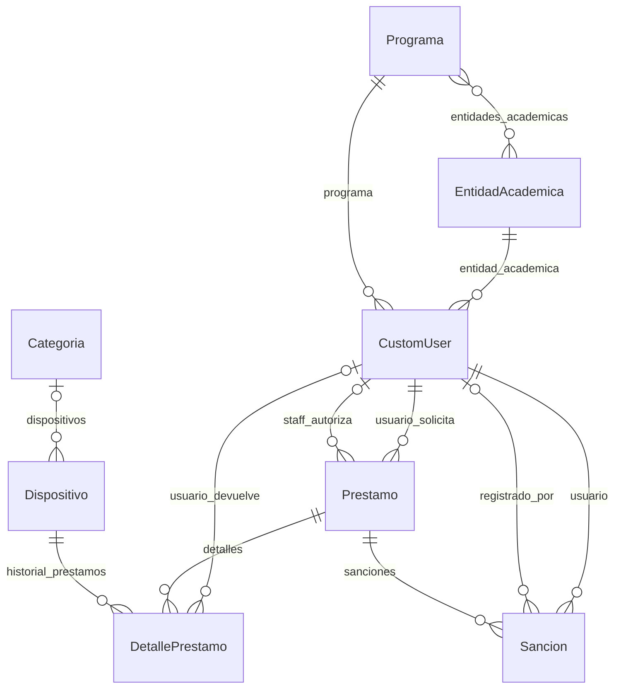

# Base de datos

Motor configurado en `PaginaRegistro/PaginaRegistro/settings.py`:

```python
ENGINE: django.db.backends.postgresql
NAME: pcpuma_db
USER: admin_pcpuma
HOST: localhost
PORT: 5433
```

El contenedor es `postgres:15-alpine` (`db_pcpuma` en Compose) y guarda los datos en el volumen `pcpuma_postgres_data`. El puerto publicado es 5433 porque el 5432 del contenedor se mapea ahí. El comentario de `settings.py` todavía dice que el puerto se expone «en tu Mac»; el mapeo del compose es el que vale.

El diccionario SQLite (`BASE_DIR / 'db.sqlite3'`) está comentado. `.gitignore` ignora `*.sqlite3`.

No hay `DEFAULT_AUTO_FIELD` en settings. Las migraciones crean las llaves primarias como `BigAutoField`.

`migrate` también crea las tablas de `django.contrib`: `auth` (grupos y permisos; `PermissionsMixin` las usa), `admin`, `contenttypes` y `sessions`. Este documento cubre los modelos del proyecto.

## Diagrama entidad-relación



`StaffUser` y `NormalUser` son proxy de `CustomUser`. No tienen tabla.

## Usuarios

### `CustomUser` (`Usuarios_customuser`)

Sustituye al usuario de Django. `USERNAME_FIELD = 'email'`.

| Campo | Tipo en el modelo | Notas |
|-------|-------------------|--------|
| `id` | `BigAutoField` | PK |
| `password` | el de `AbstractBaseUser` | hash |
| `last_login` | el de `AbstractBaseUser` | |
| `is_superuser` | `PermissionsMixin` | default `False` |
| `email` | `EmailField` | `unique=True` |
| `nombre` | `CharField(100)` | obligatorio en el manager |
| `apellidos` | `CharField(100)` | obligatorio en el manager |
| `numero_cuenta` | `CharField(20)` | nulo, alumnos |
| `numero_trabajador` | `CharField(20)` | nulo |
| `rfc` | `CharField(13)` | nulo. El modelo no valida el formato |
| `curp` | `CharField(18)` | nulo. El modelo no valida el formato |
| `genero` | `CharField(1)` | `M`, `F`, `O`, `N` |
| `direccion` | `TextField` | nulo |
| `telefono_celular` | `CharField(15)` | nulo |
| `fecha_registro` | `DateTimeField` | `auto_now_add` |
| `entidad_academica` | FK `EntidadAcademica` | `SET_NULL`, nulo, `related_name='usuarios'` |
| `programa` | FK `Programa` | `SET_NULL`, nulo, `related_name='alumnos'` |
| `huella_template` | `BinaryField` | nulo. Blob zlib+JSON, no el template de 512 bytes del AS608 |
| `is_active` | `BooleanField` | default `True` |
| `is_staff` | `BooleanField` | default `False`. El alta de staff lo pone en `True` |

`numero_cuenta`, `rfc` y `curp` no tienen `unique` ni `db_index`.

Propiedades de Python, sin columna:

- `tiene_sancion_activa`: existe `mis_sanciones` con `estado='activa'`.
- `sanciones_activas`: ese queryset.
- `prestamos_pendientes`: `prestamos_solicitados` con algún detalle `fecha_devuelto` nulo, `distinct()`.

### `EntidadAcademica`

| Campo | Notas |
|-------|--------|
| `clave` | `CharField(20)`, único. El `verbose_name` pone de ejemplo `FI`, `IIMAS` |
| `nombre` | `CharField(150)` |
| `director` | `CharField(150)`, nulo |

### `Programa`

| Campo | Notas |
|-------|--------|
| `clave` | `CharField(20)`, único |
| `nombre` | `CharField(150)` |
| `nombre_corto` | `CharField(50)`, nulo |
| `entidades_academicas` | `ManyToMany` hacia `EntidadAcademica`, `blank=True`, `related_name='programas_impartidos'` |

La migración `0003` quitó el M2M que estaba en `EntidadAcademica.programas_impartidos` y lo dejó en `Programa`. El `related_name` conserva el nombre viejo: desde una entidad se llega con `programas_impartidos`. Django crea la tabla intermedia con el nombre por defecto de ese campo. No hay `through` explícito.

El formulario de registro limita las entidades al programa elegido. Esa regla está en `AcademicProgramFormMixin` y en la vista `entidades_por_programa`, no en un `CHECK` de la base.

## Inventario

### `Categoria`

| Campo | Notas |
|-------|--------|
| `nombre` | `CharField(100)`, único |
| `descripcion` | `TextField`, nulo |

### `Dispositivo`

| Campo | Notas |
|-------|--------|
| `codigo_inventario` | `CharField(50)`, único. Etiqueta «Código de Inventario UNAM» |
| `nombre` | `CharField(200)` |
| `categoria` | FK `Categoria`, `SET_NULL`, nulo, `related_name='dispositivos'` |
| `especificaciones` | `TextField` obligatorio |
| `estado` | `CharField(20)`. Valores: `disponible` (default), `prestado`, `mantenimiento`, `extraviado` |
| `foto` | `ImageField`, `upload_to='dispositivos_fotos/'`, nulo |
| `comentarios` | `TextField`, nulo |

El paso 3 del préstamo pone `prestado` con un `UPDATE`. La devolución vuelve a `disponible` solo si el estado actual es `prestado`. El formulario de edición quita `prestado` de las opciones: ese estado lo mueven los flujos de préstamo y devolución. `mantenimiento` y `extraviado` se asignan a mano en esa edición.

`DispositivoCreateView` no incluye `estado` en `fields`. Al importar la vista ejecuta `model.estado = "Disponible"`, que no es una clave de `ESTADOS`.

## Préstamos

### `Prestamo`

Ticket. `verbose_name` «Préstamo (Ticket)».

| Campo | Notas |
|-------|--------|
| `usuario_solicita` | FK al usuario, `CASCADE`, `related_name='prestamos_solicitados'` |
| `staff_autoriza` | FK al usuario, `SET_NULL`, nulo, `related_name='prestamos_autorizados'` |
| `fecha_salida` | `auto_now_add` |
| `fecha_devolucion_esperada` | obligatorio |
| `comentarios` | `TextField`, default `""`. Lo añade la migración `0003` |

`agregar_comentario` concatena líneas y guarda solo ese campo. No hay tabla de comentarios.

Propiedades calculadas: `estado_ticket` (`Vacío`, `Pendiente (Ningún equipo devuelto)`, `Parcial (n/m devueltos)`, `Completado`), `esta_atrasado`, `etiqueta_estado` (`Completado`, `Atrasado`, `Vacío`, `Pendiente`), `clase_badge_estado`, `comentarios_devolucion` (textos distintos de los detalles ya devueltos).

### `DetallePrestamo`

| Campo | Notas |
|-------|--------|
| `prestamo` | FK `Prestamo`, `CASCADE`, `related_name='detalles'` |
| `dispositivo` | FK `Dispositivo`, `PROTECT`, `related_name='historial_prestamos'` |
| `fecha_devuelto` | nulo mientras siga prestado |
| `usuario_devuelve` | FK usuario, `SET_NULL`, nulo, `related_name='equipos_devueltos'` |
| `nombre_externo_devuelve` | `CharField(150)`, nulo. Quien devuelve y no está registrado |
| `comentarios_devolucion` | `TextField`, nulo |

No hay `unique_together` de préstamo y dispositivo. Dos detalles del mismo equipo en el mismo ticket no están prohibidos por el modelo. El paso 3 deduplica los ids antes de crearlos.

`PROTECT` impide borrar un `Dispositivo` que tenga historial.

### `Sancion`

| Campo | Notas |
|-------|--------|
| `prestamo` | FK `Prestamo`, `CASCADE`, `related_name='sanciones'` |
| `usuario` | FK usuario, `CASCADE`, `related_name='mis_sanciones'`. La vista copia `prestamo.usuario_solicita` |
| `registrado_por` | FK usuario, `SET_NULL`, nulo, `related_name='sanciones_registradas'`. Migración `0004` |
| `tipo_sancion` | `retraso_entrega`, `equipo_danado`, `extravio`, `mal_uso` |
| `estado` | `activa` (default) o `resuelta` |
| `observaciones` | `TextField` obligatorio |
| `fecha_reporte` | `auto_now_add` |

No hay fecha de fin, monto ni columna de días. Eso, si se anota, va en `observaciones`. Una sanción `activa` bloquea préstamos nuevos. No bloquea devoluciones y no se genera sola al marcar un ticket como atrasado.

## Índices

Declarados en los modelos, todos por `unique=True`:

| Tabla | Columna |
|-------|---------|
| `CustomUser` | `email` |
| `EntidadAcademica` | `clave` |
| `Programa` | `clave` |
| `Categoria` | `nombre` |
| `Dispositivo` | `codigo_inventario` |

No hay `Meta.indexes` ni `db_index=True` en ningún modelo del proyecto. Django indexa por su cuenta las llaves foráneas. Las búsquedas de pantalla por nombre, correo o código usan `icontains` y no tienen índice de texto.

`estado_ticket` y `etiqueta_estado` no se pueden indexar: no son columnas. El filtro del listado de préstamos recorre el queryset en Python.

## Formato de `huella_template`

`serializar_template` (`Usuarios/hardware/hardware.py`):

1. Redondea el `ndarray (N, 4)` a 3 decimales.
2. Lo pasa a una lista JSON.
3. Comprime con `zlib` nivel 9.

`deserializar_template` invierte el proceso y devuelve `float32`. El agente envía ese mismo blob en base64. `minucias_desde_texto` rechaza un cuerpo vacío, un base64 ilegible o una matriz que no sea 2D con al menos 4 columnas.

El índice en RAM no es una tabla. Vive en el proceso que atendió el alta o la primera búsqueda. Otro worker de Gunicorn, si algún día se usa, arranca con el diccionario vacío y lo llena en su primera identificación.

## Migraciones

No hay comandos de datos fuera de `manage.py migrate`, ni fixtures, ni `RunSQL`.

Orden real de dependencias:

| Migración | Qué hace |
|-----------|----------|
| `Usuarios.0001_initial` | `Programa`, `EntidadAcademica`, `CustomUser`. Depende de `auth.0012`. Generada con Django 6.1.2 el 2026-10-14. |
| `Usuarios.0002_customuser_huella_template` | Añade `huella_template`. |
| `Usuarios.0003_remove_entidadacademica_programas_impartidos_and_more` | Quita el M2M de la entidad y lo crea en `Programa.entidades_academicas`. |
| `Inventario.0001_initial` | `Categoria`, `Dispositivo`. |
| `Prestamos.0001_initial` | `Prestamo`, `Sancion`, `DetallePrestamo` sin las FK a usuario. Depende de `Inventario.0001_initial`. |
| `Prestamos.0002_initial` | FK `usuario_devuelve`, `staff_autoriza`, `usuario_solicita`, `usuario` de la sanción y `dispositivo`. Depende del usuario swappable. |
| `Prestamos.0003_prestamo_comentarios` | Añade `comentarios`. `RunPython` copia a ese campo los `comentarios_devolucion` ya existentes, con sello de `fecha_devuelto` y el prefijo `(Devolución)`. La reversa es `noop`. |
| `Prestamos.0004_sancion_registrado_por` | Añade `registrado_por`. |

`0001` de préstamos y `0002` se llaman ambas `initial = True` en el archivo. La cadena de `dependencies` es la que Django aplica.

Aplicar y deshacer, desde `PaginaRegistro/`:

```bash
python manage.py migrate
python manage.py showmigrations
python manage.py migrate Prestamos 0002
```

El último comando deshace `0004` y `0003` en ese orden. La copia de comentarios de `0003` no tiene reversa: bajar de `0003` elimina la columna `comentarios` sin restaurar un estado anterior de ese texto, porque el texto de detalle no se había borrado. Subir de nuevo volvería a copiar desde los detalles.
